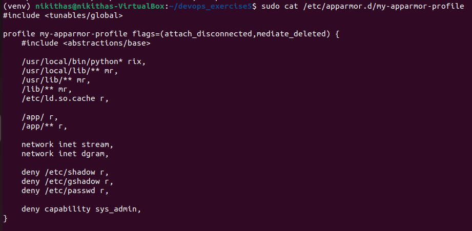
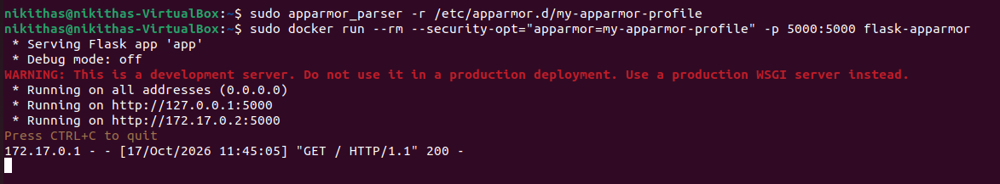
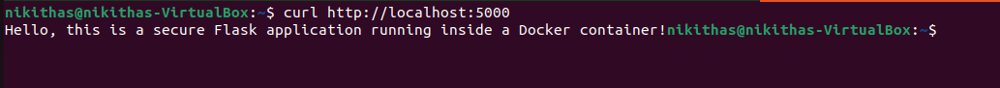
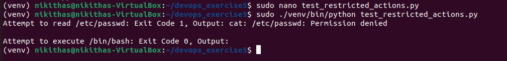

# Docker Security with AppArmor and Python – Lab Report

## Objective

Secure a Docker container running a Python Flask application by applying an AppArmor profile, apply that profile through the Docker SDK for Python, and test that restricted actions (such as reading `/etc/passwd`) are blocked inside the container.

## Environment

| Item | Value |
|---|---|
| OS | Ubuntu (VirtualBox VM, host name `nikithas-VirtualBox`) |
| Docker | Docker Engine, run with `sudo` where needed |
| Python | Virtual environment (`venv`) with the `docker` SDK installed |

## Scenario

A Python Flask web application is deployed in a Docker container. The container must be locked down so that it cannot read sensitive directories, cannot execute system binaries, and has restricted Linux capabilities. AppArmor enforces these rules, and the Docker SDK for Python is used to apply and verify the profile.

---

## Prerequisites: Install AppArmor Utilities

```bash
sudo apt-get update
sudo apt-get install apparmor-utils
pip install docker
```

`apparmor-utils` provides `apparmor_parser`, which loads profiles into the kernel. The `docker` package is the Docker SDK for Python used in Tasks 4 and 5.

---

## Task 1: Write a Basic Python Flask Application

**`app.py`**

```python
from flask import Flask

app = Flask(__name__)

@app.route('/')
def home():
    return "Hello, this is a secure Flask application running inside a Docker container!"

if __name__ == '__main__':
    app.run(host='0.0.0.0', port=5000)
```

The app serves one route (`/`) on port 5000 and listens on all interfaces so it is reachable from outside the container.

## Task 2: Containerize the Flask Application

**`Dockerfile`**

```dockerfile
FROM python:3.8-slim
WORKDIR /app
COPY . /app
RUN pip install flask
EXPOSE 5000
CMD ["python", "app.py"]
```

Build the image:

```bash
sudo docker build -t flask-apparmor .
```

This produced the image `flask-apparmor`, which is used in all later tasks.

---

## Task 3: Create and Apply the AppArmor Profile

### a. Create the profile

The profile was written with `nano` and saved at `/etc/apparmor.d/my-apparmor-profile`:

```bash
sudo nano /etc/apparmor.d/my-apparmor-profile
```

Contents (verified afterwards with `sudo cat`):

```
#include <tunables/global>

profile my-apparmor-profile flags=(attach_disconnected,mediate_deleted) {
    #include <abstractions/base>

    /usr/local/bin/python* rix,
    /usr/local/lib/** mr,
    /usr/lib/** mr,
    /lib/** mr,
    /etc/ld.so.cache r,

    /app/ r,
    /app/** r,

    network inet stream,
    network inet dgram,

    deny /etc/shadow r,
    deny /etc/gshadow r,
    deny /etc/passwd r,

    deny capability sys_admin,
}
```



What each rule does:

| Rule | Effect |
|---|---|
| `#include <abstractions/base>` | Includes basic AppArmor rules and abstractions for common system operations. |
| `/usr/local/bin/python* rix,` | Allows matching Python executables to be executed with inherited profile permissions. |
| `/usr/local/lib/** mr,` | Allows reading and memory mapping files under `/usr/local/lib/`. |
| `/usr/lib/** mr,` | Allows reading and memory mapping files under `/usr/lib/`. |
| `/lib/** mr,` | Allows reading and memory mapping files under `/lib/`. |
| `/etc/ld.so.cache r,` | Allows reading the dynamic linker cache needed to locate shared libraries. |
| `/app/ r,` | Allows reading the application directory. |
| `/app/** r,` | Allows reading files and directories under `/app/`. |
| `network inet stream,` | Allows IPv4 stream socket operations, commonly used for TCP connections. |
| `network inet dgram,` | Allows IPv4 datagram socket operations, commonly used for UDP communication. |
| `deny /etc/shadow r,` | Denies reading `/etc/shadow`, which stores password hashes. |
| `deny /etc/gshadow r,` | Denies reading `/etc/gshadow`, which stores protected group-password information. |
| `deny /etc/passwd r,` | Denies reading `/etc/passwd`, which contains local user account information. |
| `deny capability sys_admin,` | Denies use of the `CAP_SYS_ADMIN` capability, which grants a broad set of administrative operations. |

### b. Load the profile

```bash
sudo apparmor_parser -r /etc/apparmor.d/my-apparmor-profile
```

The command returned silently, which means the profile parsed and loaded without errors (`-r` reloads/replaces the profile).

### c. Run the container with the profile

```bash
sudo docker run --rm --security-opt="apparmor=my-apparmor-profile" -p 5000:5000 flask-apparmor
```

The container started, Flask reported it was running on `0.0.0.0:5000` (container IP `172.17.0.2`), and the first request from the host was answered with `GET / HTTP/1.1" 200`.



### Verify the application still works

From a second terminal:

```bash
curl http://localhost:5000
```

The application returned its greeting message, showing that the profile still allows the app to serve traffic (network and `/app` access are permitted).



---

## Task 4: Apply the AppArmor Profile with the Docker SDK for Python

**`apply_apparmor.py`**

```python
import docker

client = docker.from_env()

print("Building image from Dockerfile...")
client.images.build(path=".", tag="flask-apparmor")

print("Running container with AppArmor profile...")

container = client.containers.run(
    "flask-apparmor",
    ports={"5000/tcp": 5000},
    security_opt=["apparmor=my-apparmor-profile"],
    detach=True
)

try:
    print(f"Container started: {container.short_id}")

    container_info = client.api.inspect_container(container.id)
    apparmor_profile = container_info["HostConfig"]["SecurityOpt"]

    print(f"AppArmor security options: {apparmor_profile}")
    print(f"Active AppArmor profile: {container_info.get('AppArmorProfile')}")

finally:
    print("Stopping the container...")
    container.stop(timeout=5)
    container.remove()
    print("Container stopped.")
```

Run inside the virtual environment:

```bash
sudo ./venv/bin/python apply_apparmor.py
```

The script printed the short ID of the new container and then `AppArmor profile applied: ['apparmor=…']`, which confirms Docker recorded the profile in the container's `HostConfig.SecurityOpt`. Afterwards `sudo docker ps` was run to check the state of running containers; only the column headers are visible, consistent with the script having stopped the container at the end.


---

## Task 5: Test Restricted Actions

**`test_restricted_actions.py`**

```python
import docker

# Create a Docker client
client = docker.from_env()

# Run the container with the AppArmor profile
container = client.containers.run(
    "flask-apparmor",
    ports={'5000/tcp': 5000},
    security_opt=["apparmor=my-apparmor-profile"],
    detach=True
)

# Test restricted actions
exit_code, output = container.exec_run("cat /etc/passwd")
print(f"Attempt to read /etc/passwd: Exit Code {exit_code}, Output: {output.decode()}")

exit_code, output = container.exec_run("/bin/bash")
print(f"Attempt to execute /bin/bash: Exit Code {exit_code}, Output: {output.decode()}")

# Stop the container
container.stop()
```

Run:

```bash
sudo ./venv/bin/python test_restricted_actions.py
```

Result observed for the test:

```
Attempt to read /etc/passwd: Exit Code 1, Output: cat: /etc/passwd: Permission denied
Attempt to execute /bin/bash: Exit Code 0, Output: 
```





---

## Results Summary

| Test | Expected | Observed |
|---|---|---|
| Profile loads with `apparmor_parser -r` | No errors | No errors |
| Container runs with `--security-opt apparmor=…` | Starts normally | Started; Flask served on port 5000 |
| `curl http://localhost:5000` | Greeting returned | Greeting returned (HTTP 200) |
| SDK applies profile | `SecurityOpt` lists the profile | Profile shown in script output |
| Read `/etc/passwd` in container | Denied | `Permission denied`, Exit Code 1 |
| Execute `/bin/bash` in container | Denied | Exit Code 0 |

## Observations

- The application keeps working (network and `/app` are allowed) while access to sensitive paths is removed, which is the principle of least privilege.
- Enforcement happens in the kernel through AppArmor, so it applies even if the process inside the container runs as root.
- The Docker SDK lets the same security options be applied programmatically (`security_opt=[...]`) and checked with `inspect_container`, which is useful for automation and testing.
- The profile name passed to Docker must match a profile that has been loaded into the kernel;
- The Flask warning about the development server is expected; a production deployment should use a WSGI server such as Gunicorn.
