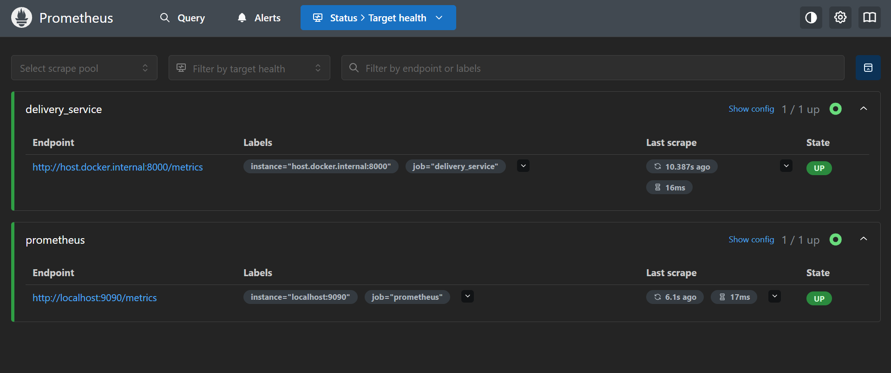
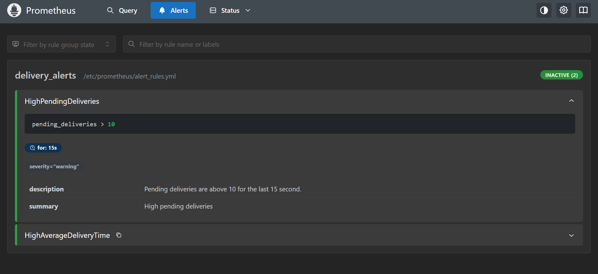
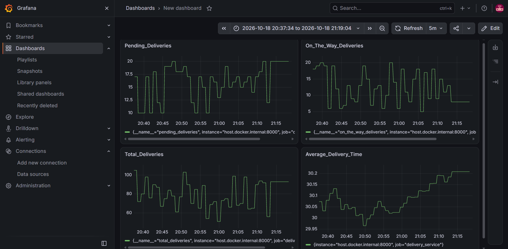
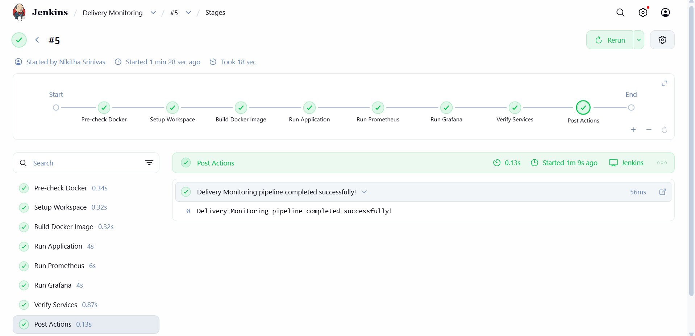
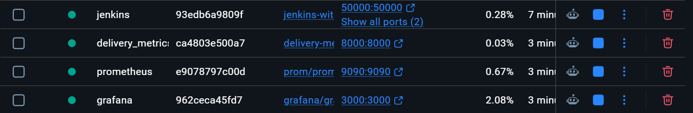

# Exercise 6- ZAPPTTO Delivery Monitoring: Real-Time Operations Monitoring and Alerting

A small monitoring stack for a fast-paced delivery service. A Python app simulates delivery metrics, **Prometheus** scrapes them and evaluates alert rules, **Grafana** visualizes them, and **Jenkins** automates building and running the application.


| Component | Container | Port | Purpose |
|---|---|---|---|
| Delivery metrics app | `delivery_metrics` | 8000 | Exposes simulated metrics at `/metrics` |
| Prometheus | `prometheus` | 9090 | Scrapes metrics, evaluates alerts |
| Grafana | `grafana` | 3000 | Dashboards |
| Jenkins | `jenkins` | 8081, 50000 | CI/CD pipeline |

## Prerequisites

- Docker
- Python 3.10+
- `prometheus-client` (`pip install prometheus-client`)

## Results

### Prometheus targets are up

Both `delivery_service` and `prometheus` scrape targets report `UP`.



### Alerts



### Grafana dashboard



### Jenkins pipeline

**Note:** Port 8080 was already in use, so port 8081 was used to access Jenkins.
All stages passed in build #5.



Console output:
```bash
Started by user Nikitha Srinivas

[Pipeline] Start of Pipeline
[Pipeline] node
Running on Jenkins
 in /var/jenkins_home/workspace/Delivery Monitoring
[Pipeline] {
[Pipeline] stage
[Pipeline] { (Pre-check Docker)
[Pipeline] sh
+ set -e
+ docker --version
Docker version 26.1.5+dfsg1, build a72d7cd
+ docker info
Client:
 Version:    26.1.5+dfsg1
 Context:    default
 Debug Mode: false

Server:
 Containers: 8
  Running: 4
  Paused: 0
  Stopped: 4
 Images: 19
 Server Version: 29.6.2
 Storage Driver: overlayfs
  driver-type: io.containerd.snapshotter.v1
 Logging Driver: json-file
 Cgroup Driver: cgroupfs
 Cgroup Version: 2
 Plugins:
  Volume: local
  Network: bridge host ipvlan macvlan null overlay
  Log: awslogs fluentd gcplogs gelf journald json-file local splunk syslog
 CDI spec directories:
  /etc/cdi
  /var/run/cdi
 Swarm: inactive
 Runtimes: io.containerd.runc.v2 nvidia runc
 Default Runtime: runc
 Init Binary: docker-init
 containerd version: e53c7c1516c3b2bff98eb76f1f4117477e6f4e66 (expected: )
 runc version: v1.3.6-0-g491b69ba (expected: )
 init version: de40ad0 (expected: )
 Security Options:
  seccomp
   Profile: builtin
  cgroupns
 Kernel Version: 6.18.33.2-microsoft-standard-WSL2
 Operating System: Docker Desktop
 OSType: linux
 Architecture: x86_64
 CPUs: 8
 Total Memory: 7.632GiB
 Name: docker-desktop
 ID: c5e23a1c-5026-4e24-bd10-d84bc8606405
 Docker Root Dir: /var/lib/docker
 Debug Mode: false
 HTTP Proxy: http.docker.internal:3128
 HTTPS Proxy: http.docker.internal:3128
 No Proxy: hubproxy.docker.internal
 Labels:
  com.docker.desktop.address=npipe://\\.\pipe\docker_cli
 Experimental: false
 Insecure Registries:
  hubproxy.docker.internal:5555
  ::1/128
  127.0.0.0/8
 Live Restore Enabled: false

[Pipeline] }
[Pipeline] // stage
[Pipeline] stage
[Pipeline] { (Setup Workspace)
[Pipeline] sh
+ set -e
+ [ -f /workspace/devops_exercise6/delivery_metrics.py ]
+ SRC=/workspace/devops_exercise6
+ cp /workspace/devops_exercise6/delivery_metrics.py /var/jenkins_home/workspace/Delivery Monitoring/
+ cp /workspace/devops_exercise6/prometheus.yml /var/jenkins_home/workspace/Delivery Monitoring/
+ cp /workspace/devops_exercise6/alert_rules.yml /var/jenkins_home/workspace/Delivery Monitoring/
+ cp /workspace/devops_exercise6/Dockerfile /var/jenkins_home/workspace/Delivery Monitoring/
+ echo Files copied successfully:
Files copied successfully:
+ ls -la /var/jenkins_home/workspace/Delivery Monitoring
total 24
drwxr-xr-x 2 jenkins jenkins 4096 Oct 18 17:41 .
drwxr-xr-x 4 jenkins jenkins 4096 Oct 18 16:55 ..
-rwxr-xr-x 1 jenkins jenkins  137 Oct 18 17:44 Dockerfile
-rwxr-xr-x 1 jenkins jenkins  669 Oct 18 17:44 alert_rules.yml
-rwxr-xr-x 1 jenkins jenkins 1503 Oct 18 17:44 delivery_metrics.py
-rwxr-xr-x 1 jenkins jenkins  259 Oct 18 17:44 prometheus.yml
+ test -f /var/jenkins_home/workspace/Delivery Monitoring/delivery_metrics.py
+ test -f /var/jenkins_home/workspace/Delivery Monitoring/prometheus.yml
+ test -f /var/jenkins_home/workspace/Delivery Monitoring/alert_rules.yml
+ test -f /var/jenkins_home/workspace/Delivery Monitoring/Dockerfile
[Pipeline] }
[Pipeline] // stage
[Pipeline] stage
[Pipeline] { (Build Docker Image)
[Pipeline] sh
+ set -e
+ docker build -t delivery-metrics /var/jenkins_home/workspace/Delivery Monitoring
DEPRECATED: The legacy builder is deprecated and will be removed in a future release.
            Install the buildx component to build images with BuildKit:
            https://docs.docker.com/go/buildx/

Sending build context to Docker daemon  6.656kB

Step 1/5 : FROM python:3.12-slim
 ---> a6e34c598f24
Step 2/5 : WORKDIR /app
 ---> Using cache
 ---> 8458cfeeb53e
Step 3/5 : RUN pip install prometheus-client
 ---> Using cache
 ---> 06b996d243f2
Step 4/5 : COPY delivery_metrics.py .
 ---> Using cache
 ---> a5b7055af454
Step 5/5 : CMD ["python", "delivery_metrics.py"]
 ---> Using cache
 ---> 15b9888af37b
Successfully built 15b9888af37b
Successfully tagged delivery-metrics:latest
[Pipeline] }
[Pipeline] // stage
[Pipeline] stage
[Pipeline] { (Run Application)
[Pipeline] sh
+ set -e
+ docker rm -f delivery_metrics
delivery_metrics
+ docker network inspect delivery-monitoring-net
+ docker network create delivery-monitoring-net
8be941fc4baa940c108d108a1fc07ac0fa9c75b8baeeb865b3125c5c757ae777
+ docker run -d --name delivery_metrics --network delivery-monitoring-net -p 8000:8000 delivery-metrics
ca4803e500a75b194cdca9bcafa8996636df91c461703bc886aeacec51626dad
+ sleep 3
+ docker ps --filter name=delivery_metrics
CONTAINER ID   IMAGE              COMMAND                  CREATED         STATUS         PORTS                                       NAMES
ca4803e500a7   delivery-metrics   "python delivery_met…"   4 seconds ago   Up 3 seconds   0.0.0.0:8000->8000/tcp, :::8000->8000/tcp   delivery_metrics
[Pipeline] }
[Pipeline] // stage
[Pipeline] stage
[Pipeline] { (Run Prometheus)
[Pipeline] sh
+ set -e
+ docker rm -f prometheus
prometheus
+ docker run -d --name prometheus --network delivery-monitoring-net -p 9090:9090 prom/prometheus:latest
e9078797c00df654e4eb2827aab5d6368a194ef95e04ff784f89173887fd35cb
+ docker cp /var/jenkins_home/workspace/Delivery Monitoring/prometheus.yml prometheus:/etc/prometheus/prometheus.yml
+ docker cp /var/jenkins_home/workspace/Delivery Monitoring/alert_rules.yml prometheus:/etc/prometheus/alert_rules.yml
+ docker restart prometheus
prometheus
+ sleep 5
+ docker ps --filter name=prometheus
CONTAINER ID   IMAGE                    COMMAND                  CREATED         STATUS         PORTS                                       NAMES
e9078797c00d   prom/prometheus:latest   "/bin/prometheus --c…"   5 seconds ago   Up 5 seconds   0.0.0.0:9090->9090/tcp, :::9090->9090/tcp   prometheus
[Pipeline] }
[Pipeline] // stage
[Pipeline] stage
[Pipeline] { (Run Grafana)
[Pipeline] sh
+ set -e
+ docker rm -f grafana
grafana
+ docker run -d --name grafana --network delivery-monitoring-net -p 3000:3000 grafana/grafana:latest
962ceca45fd7e5ac39e469fd8b5f4a5ebb0dbb2f3db0f9620f46dc4f20dbf8e3
+ sleep 3
+ docker ps --filter name=grafana
CONTAINER ID   IMAGE                    COMMAND     CREATED         STATUS         PORTS                                       NAMES
962ceca45fd7   grafana/grafana:latest   "/run.sh"   4 seconds ago   Up 3 seconds   0.0.0.0:3000->3000/tcp, :::3000->3000/tcp   grafana
[Pipeline] }
[Pipeline] // stage
[Pipeline] stage
[Pipeline] { (Verify Services)
[Pipeline] sh
+ echo === Running containers ===
=== Running containers ===
+ docker ps
CONTAINER ID   IMAGE                    COMMAND                  CREATED          STATUS          PORTS                                                                                      NAMES
962ceca45fd7   grafana/grafana:latest   "/run.sh"                5 seconds ago    Up 4 seconds    0.0.0.0:3000->3000/tcp, :::3000->3000/tcp                                                  grafana
e9078797c00d   prom/prometheus:latest   "/bin/prometheus --c…"   11 seconds ago   Up 10 seconds   0.0.0.0:9090->9090/tcp, :::9090->9090/tcp                                                  prometheus
ca4803e500a7   delivery-metrics         "python delivery_met…"   16 seconds ago   Up 15 seconds   0.0.0.0:8000->8000/tcp, :::8000->8000/tcp                                                  delivery_metrics
93edb6a9809f   jenkins-with-docker      "/usr/bin/tini -- /u…"   4 minutes ago    Up 4 minutes    0.0.0.0:50000->50000/tcp, :::50000->50000/tcp, 0.0.0.0:8081->8080/tcp, :::8081->8080/tcp   jenkins
+ echo === Application metrics endpoint ===
=== Application metrics endpoint ===
+ docker exec delivery_metrics python -c import urllib.request; print(urllib.request.urlopen('http://localhost:8000/metrics').status)
200
+ echo === Prometheus ===
=== Prometheus ===
+ docker exec prometheus wget -qO- http://localhost:9090/-/healthy
Prometheus Server is Healthy.
+ echo 

+ echo Monitoring containers started.
Monitoring containers started.
+ echo Application metrics: http://localhost:8000/metrics
Application metrics: http://localhost:8000/metrics
+ echo Prometheus: http://localhost:9090
Prometheus: http://localhost:9090
+ echo Grafana: http://localhost:3000
Grafana: http://localhost:3000
[Pipeline] }
[Pipeline] // stage
[Pipeline] stage
[Pipeline] { (Declarative: Post Actions)
[Pipeline] echo
Delivery Monitoring pipeline completed successfully!
[Pipeline] }
[Pipeline] // stage
[Pipeline] }
[Pipeline] // node
[Pipeline] End of Pipeline
Finished: SUCCESS
```

### Running containers

`prometheus`, `grafana`, `jenkins` and `delivery_metrics` are all up.



## Simulating Alerts

The default `pending` range is `random.randint(10, 20)`, which already exceeds the alert threshold most of the time. To push it well past the threshold, edit `delivery_metrics.py`:

```python
pending = random.randint(50, 100)
```

Then rebuild/restart the app (re-run the Jenkins pipeline) and check **Alerts** in the Prometheus UI.

## Cleanup

```bash
docker rm -f delivery_metrics prometheus grafana jenkins
```